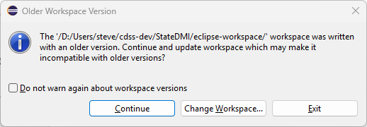
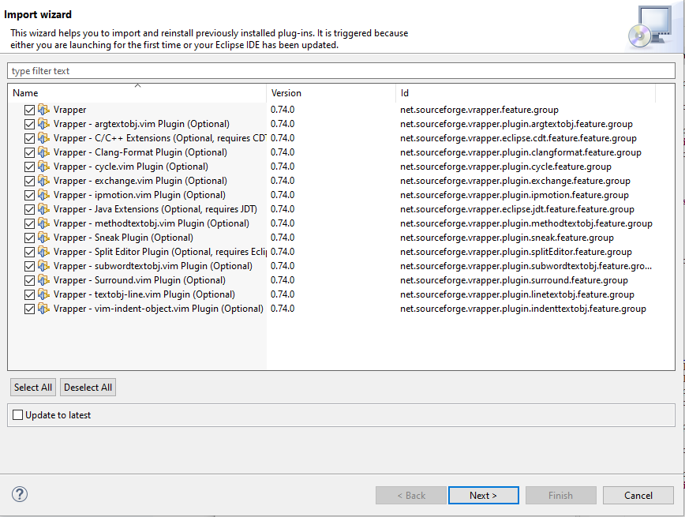

# StateDMI / Update Java / Overview ##

This documentation describes the steps needed when updating the Java version.

*   [Introduction](#introduction)
*   [Update Java from Version 8 to 11](#update-java-from-version-8-to-11)

------------------

## Introduction ##

*Updated:  2026-03-02*

StateDMI is written in the Java language and is developed using the Eclipse IDE, which runs Java.
Java is a mature language but continues to be enhanced over time.
The Java development tools must also be updated to be compatible with newer operating systems.
This documentation summarizes steps that were taken to update Java from one version to another.
The documentation is based on similar documentation that was created for the TSTool software.

## Update Java from Version 8 to 11 ##

Java 8 was used for many years due to its stability.
StateDMI 6.0.0 was updated to use Java 11 in 2026 and the plan is to update StateDMI to newer
long-term support (LTS) releases every several years to ensure that StateDMI's version of Java is up to date.
StateDMI will be updated after TSTool's Java version is updated.

Updating the version from 8 to 11 required a number of basic changes,
including handling simple version number like `11` whereas previously `1_8` or `18` was used
due to Java historical version conventions.

The following steps were taken to update an existing development environment from Java 8 to 11.
The developer documentation was updated as software was updated.

1.  Backup files:
    *   Copy the entire `StateDMI` `cdss-app-statedmi-main` repository development folder local repository working files to a backup folder.
        These files will only be used for comparison as necessary and can be removed in the future.
    *   Other repositories (and Eclipse projects) were backed up when TSTool was updated and can be referenced as needed.
        The StateDMI main application files are the focus for this update since the other libraries
        were previously updated with TSTool.
2.  Install Java 11:
    *   Previously done for TSTool.
    *   OK to leave Java 8 if it exists because it may be used by other software (can remove later).
3.  Install Eclipse 2022-06, which is the last Eclipse version that runs with Java 11:
    *   Previously done for TSTool.
    *   Make sure that the Eclipse version is compatible with the Java version used with Eclipse.
        Otherwise, an error may result that is difficult to troubleshoot.
    *   OK to leave 2019-03 if it exists because it may be used by other software.
    *   Update the Eclipse run script to use the latest Eclipse and Java:
        +   `build-util/run-eclipse-win64.cmd`
4.  Update the runtime scripts:
    *   Update the `resources/runtime/bin/README.md` file.
    *   Unlike TSTool, StateDMI does not currently provide a run-time script.
5.  Update the Linux distribution build scripts:
    *   Unlike TSTool, StateDMI does not currently provide a Linux build script.
6.  Run Eclipse:
    *   Use the `build-util/run-eclipse-win64.cmd` script in a Windows command shell.
        -   It should find the Eclipse 2022-06 version.
        -   If an error dialog is shown, try running the `eclipse.exe` program in the Eclipse installation folder
            (cancel before opening the workspace).
        -   If the above works but still have an error from the run script,
            try editing the run script to add other command line parameters until the problem is identified.
    *   A warning may be shown as follows.  Press ***Continue*** to update the workspace configuration.

        **

        
        
**

        **

        Older Workspace Version Warning (<a href="../1-older-workspace-warning.png">see full-size image</a>)
        
**

    *   A dialog may be shown as follows to update Eclipse plug-ins.
        In this case, the ***Vrapper*** plug-in was previously installed to provide "vim" editor behavior within Eclipse.
        This may not be shown if plug-ins were previously updated for the TSTool development environment.
        Press ***Next >*** to update the plugins that are listed.
        Additional confirmation steps may occur.

        **

        
        
**

        **

        Plugin Import Wizard (<a href="../2-plugin-import.png">see full-size image</a>)
        
**

    *   Eclipse will rebuild the projects and may prompt to restart to apply the software update.
        Pressing ***Restart Now*** to continue may not properly restart.
        Restart Eclipse using the run script.

7.  Additional Eclipse configuration:
    *   The Java software and Java compatibility version need to be updated to Java 11.
        See the [New Developer Setup / Overview / Additional Eclipse Configuration](../dev-new/overview.md#additional-eclipse-configuration) documentation.
    *   StateDMI steps will be similar, but for StateDMI projects (TSTool uses additional libraries, repositories, and Eclipse projects).
    *   Changes that are specific to StateDMI are:
        -   Use the `cdss-app-statedmi-main` repository for the main StateDMI application.

8.  Code changes:
    1.  The following project changes were made:
    
        | **Project**&nbsp;&nbsp;&nbsp;&nbsp;&nbsp;&nbsp;&nbsp;&nbsp;&nbsp;&nbsp;&nbsp;&nbsp;&nbsp;&nbsp;&nbsp;&nbsp;&nbsp;&nbsp;&nbsp;&nbsp;&nbsp;&nbsp;&nbsp;&nbsp;&nbsp;&nbsp;&nbsp;&nbsp;&nbsp;&nbsp;&nbsp;&nbsp;&nbsp;&nbsp;&nbsp;&nbsp;&nbsp;&nbsp;&nbsp;&nbsp;&nbsp;&nbsp;&nbsp;&nbsp;&nbsp;&nbsp;&nbsp;| **Change** |
        | -- | -- |
        | `cdss-app-statedmi-main` | Had to delete the project and then re-import. |
        | `cdss-lib-processor-ts-java` | Work on TSTool had moved the `lib/Microsoft-SQLServer/mssql-jdbc-13.2.1.jre11.jar` JDBC driver file into `cdss-lib-processor-ts-java`, which is not used with StateDMI.  To support consistent libraries for TSTool and StateDMI, move the jar file into the `cdss-lib-common-java` repository and add to the build path.  The TSTool configuration is adjusted similarly. |
        | Various | Update StateDMI code to conform to Java 11 standards, including:<ul><li>Creating Java `Integer` and other types now use the `valueOf()` method.</li><li>Mouse right-click events are updated from the `getModifiers()` to `getModifiersEx()` method.</li></ul> |

    2.  After the above, errors remained due to StateDMI commands needing to be updated for new library code.

        | **Package**&nbsp;&nbsp;&nbsp;&nbsp;&nbsp;&nbsp;&nbsp;&nbsp;&nbsp;&nbsp;&nbsp;&nbsp;&nbsp;&nbsp;&nbsp;&nbsp;&nbsp;&nbsp;&nbsp;&nbsp;&nbsp;&nbsp;&nbsp;&nbsp;&nbsp;&nbsp;&nbsp;&nbsp;&nbsp;&nbsp;&nbsp;&nbsp;&nbsp;&nbsp; | **Class**&nbsp;&nbsp;&nbsp;&nbsp;&nbsp;&nbsp;&nbsp;&nbsp;&nbsp;&nbsp;&nbsp;&nbsp;&nbsp;&nbsp;&nbsp;&nbsp;&nbsp;&nbsp;&nbsp;&nbsp;&nbsp;&nbsp;&nbsp;&nbsp; | **Change** |
        | -- | -- | -- |
        | `rti.tscommandprocessor.` `commands.table` | `AppendTable_Command` and dialog | Copy new code from `cdss-lib-processor-ts-java` to fix errors. |
        | `rti.tscommandprocessor.` `commands.table` | `CompareTables_Command` and dialog | Copy new code from `cdss-lib-processor-ts-java` to fix errors. |
        | `rti.tscommandprocessor.` `commands.table` | `ManipulateTableString_Command` and dialog | Copy new code from `cdss-lib-processor-ts-java` to fix errors. |
        | `rti.tscommandprocessor.` `commands.table` | `TableMath_Command` and dialog | Copy new code from `cdss-lib-processor-ts-java` to fix errors. |
        | `rti.tscommandprocessor.` `commands.table` | `WriteTableToHTML_Command` and dialog | Copy new code from `cdss-lib-processor-ts-java` to fix errors. |
        | | Other similar changes can be made in the future by copying the latest `cdss-lib-processor-ts-java` classes if new functionality is needed. |

9.  Build system:
    1.  Update the `conf/product.properties` files to use Java 11 instead of 8.
    2.  Adjust library dependencies based on the above changes.
    3.  Update the `cdss-util-buildtools` project for Java 11.
        *   These changes were previously made for TSTool.
        *   Add support for simple integer main version like `11` and phase out more complex `1.8` notation.
            -   `common.xml`
            -   `common-installer.xml`
            -   `conf/product.properties` - default properties
   4.  The `cdss-app-statedmi-main/installer/CDSS/StateDMI.nsi` is OK without changes.
   5.  The `cdss-app-statedmi-main/externals/CDSS/installer/CDSS/cdss.nsh` is OK without changes.
   6.  Update the `cdss-util-buildutils/externals/NSIS_Common/JRE.nsh`:
       *   This has previously been changed for TSTool.
       *   As of Java 9, the `rt.jar` file is not used and instead Jigsaw modules are used.
           Disable the old code.
   7.  Update `launch4j`:
       *   This has previously been changed for TSTool.
       *   Successfully created an NSIS installer with the above changes, but StateDMI had an error launching.
       *   Use `launch4j` version 3.50 and save in the `cdss-util-buildtools/lib/launch4j` folder.
       *   Save the old version to the `launch4j-java` folder.
       *   This did not end up being the issue but keep the newer version.
